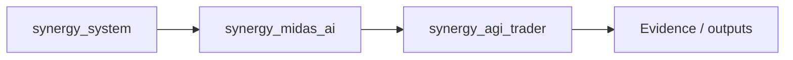
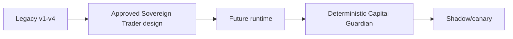

# SHTENCO Synergy AGI Trader

**SHTENCO SEAL Sovereign Trader** is an experimental LLM-native autonomous trading research system. The central idea is deliberately different from a conventional trading robot: **the LLM is the trader**, while quantitative models, indicators, retrieval, market-data adapters and specialist models are tools available to that trader.

The target system maintains a persistent trading identity, an explicit philosophy inspired by elite discretionary traders, a structured world model, beliefs and falsifiable trade theses, multiple forms of memory, internal adversarial deliberation, event-driven position management, post-trade reflection and SEAL-style self-adaptation.

> Research software. Historical backtests, paper trading and staged canary deployment are required before any constrained live use. Nothing in this repository is a guarantee of profitability.

---

## Project objective

The project is being developed toward a **self-improving digital trader**, not toward a fixed `features -> classifier -> BUY/SELL` pipeline.

The intended cognition loop is:

```text
market/event
   -> perception and tool calls
   -> world-model update
   -> memory retrieval
   -> hypothesis generation
   -> internal trader council
   -> sovereign LLM decision
   -> TradeThesis + DecisionIntent
   -> deterministic Capital Guardian
   -> execution / shadow action
   -> outcome observation
   -> reflection
   -> memory + beliefs
   -> SEAL SelfEdit candidate
   -> hidden evaluation / shadow / canary
   -> optional promotion to a new champion
```

The most important invariant is:

> **The LLM searches for, interprets and expresses the trading thesis. A deterministic Capital Guardian remains outside the mutable LLM/SEAL boundary and may reject, reduce or block any account action.**

---

## Current repository status

This repository contains two layers that must not be confused.

### 1. Approved target architecture

The target architecture is described in:

`docs/superpowers/specs/2026-09-17-shtenco-seal-sovereign-trader-design.md`

It defines the future Sovereign Trader runtime: identity, Trader Constitution, cognitive roles, memory model, `Belief`, `Hypothesis`, `TradeThesis`, `DecisionIntent`, `SelfEdit`, event-driven cognition, Capital Guardian and the SEAL inner/outer loops.

### 2. Historical research lineage

Four earlier generations are preserved as baselines and research material:

- `legacy/v1/agi_trader_final_v1.py` — philosophy-first AGI Trader baseline.
- `legacy/v2/ai_trader_seal_rl_forward.py` — SEAL/RL/forward-testing generation.
- `legacy/v3/ai_trader_quantum_fusion_bip39_seal.py` — quantum/BIP39 fusion experiment.
- `legacy/v4/ai_trader_SEAL_with_RL_MINIMAL.py` — SEAL + lightweight RL generation.

The corresponding research articles are kept under `research/articles/`.

The historical code is preserved for provenance and controlled comparison. It is **not automatically the production implementation of the approved Sovereign Trader architecture**.

---

## Foundation bundle and provenance

The repository also contains a byte-verifiable foundation archive under:

`archive/foundation_xz/`

It is split into Git-friendly parts. `scripts/unpack_foundation.py` reconstructs the payload, verifies its SHA-256 and safely extracts the prepared research tree.

```bash
python scripts/unpack_foundation.py
```

Expected foundation archive SHA-256:

```text
6d32722a9eefc174b38b33fbad9df4df9a41cd63393f1ecc027e992a428e44b0
```

`MIGRATION_MANIFEST.json` records source provenance, file sizes and SHA-256 checksums for the imported research artifacts. This makes the migration auditable and prevents silent corruption or accidental substitution of historical source files.

---

## Sovereign Trader cognition

The final trading decision belongs to one persistent **Sovereign Trader**. Internal roles are temporary cognitive viewpoints, not independent bots with their own accounts.

The design currently includes these perspectives:

- **Market Observer** — separates observed facts from interpretation.
- **Macro/Narrative Analyst** — rates, central banks, macro catalysts and market narrative.
- **Reflexivity / Soros lens** — participant beliefs, reflexive feedback loops and fallibility.
- **Trend / Livermore lens** — trend structure, confirmation, pyramiding discipline and invalidation.
- **Asymmetry / Jones lens** — downside, invalidation, risk/reward and survival first.
- **Portfolio / Dalio lens** — correlated exposures, concentration and hidden factor bets.
- **Bull Advocate** — strongest defensible long thesis.
- **Bear Advocate** — strongest defensible short thesis.
- **Contrarian / Counterfactual Critic** — asks what would make the consensus wrong.
- **Memory Librarian** — retrieves the most relevant historical episodes without leaking future information.

A post-trade **Self-Critic / SEAL Editor** is intentionally separated from the pre-trade council. The component proposing a change to the trader must not be the only component judging that change.

---

## Trader Constitution

The philosophy layer is not intended to be a collection of slogans. It is a decision framework.

Examples of the target interpretation:

- **Soros / reflexivity:** model participant beliefs, identify feedback loops between perception and market reality, and explicitly represent fallibility.
- **Paul Tudor Jones / asymmetry:** define invalidation before risking capital and reject trades where the downside cannot be bounded coherently.
- **Dalio / portfolio risk:** reason in terms of underlying factor exposure rather than treating every symbol as independent.
- **Livermore / trend discipline:** distinguish trend-following from counter-trend trades and avoid mechanically averaging a losing thesis.

Specific thresholds such as a fixed `1:2` risk/reward ratio are treated as starting heuristics rather than immutable economic laws. A Sovereign Trader may deviate only when it can state the reason and the evidence.

---

## Memory architecture

The target system separates memory by purpose:

1. **Working memory** — current market context and active reasoning state.
2. **Episodic memory** — individual decisions and outcomes.
3. **Regime memory** — experiences associated with market regimes.
4. **Mistake memory** — high-value errors, especially confident errors.
5. **Playbook memory** — generalized recurring patterns and their failure conditions.
6. **Semantic market memory** — durable concepts and relationships.
7. **Philosophy memory** — constitution and explicit trading principles.
8. **Self-model memory** — what the trader has learned about its own systematic biases and calibration failures.

`WAIT`, `SKIP` and rejected ideas are not discarded. They should be maintained in a **shadow ledger** so the system can later determine whether abstention was correct. This is required to avoid learning only from self-selected trades.

---

## SEAL adaptation

The planned adaptation stack has two speeds.

### Fast adaptation

```text
experience -> reflection -> episodic/mistake memory -> belief/playbook update
```

This changes context and retrieved knowledge without rewriting model weights after every trade.

### Slow adaptation

```text
many evaluated episodes
 -> high-value SelfEdits
 -> training dataset
 -> LoRA/QLoRA candidate
 -> hidden evaluation
 -> stress testing
 -> shadow deployment
 -> canary
 -> champion or rollback
```

A profitable trade is not automatically a good training example, and a losing trade is not automatically a bad one. SEAL candidates are evaluated primarily on whether the proposed self-edit improves decisions on **other unseen episodes**.

The deterministic Capital Guardian is outside this adaptation boundary and cannot be rewritten by the trader.

---

## Model policy

The current research baseline historically used local Ollama/Llama-family models. For the 2026 re-evaluation, the preferred small-model candidate is now:

```text
Qwen/Qwen3.5-4B
```

Reason: it is the newest strong Qwen model in the current ~3–4B size class. There is no exact dense 3B model in the current Qwen3.5 release set; using the obsolete Qwen2.5-3B only to hit an exact parameter count would sacrifice a generation of capability.

The LLM must not invent calibrated probability merely because it can output a percentage. Confidence and calibration metrics should be evaluated separately from prose reasoning.

---

## 2026 historical evaluation protocol

The current research task is to evaluate the trader on real 2026 market data while preventing obvious leakage.

The intended protocol is:

1. locate and validate the user's historical market-data archive;
2. verify timestamps, symbols, timeframe, duplicate bars, missing intervals and OHLC consistency;
3. isolate the 2026 evaluation window;
4. ensure all indicators at time `t` use only data known at `t`;
5. ensure outcome labels and trade exits do not leak across the decision timestamp;
6. feed market state to the LLM only at explicit decision events;
7. preserve every ex-ante thesis before seeing the outcome;
8. include spread/commission/slippage/swap assumptions in net PnL;
9. record performed trades and shadow outcomes for skipped trades;
10. report both prediction and economic metrics.

At minimum the report should contain:

- date range and instruments;
- bar count and data-quality diagnostics;
- number of LLM decisions;
- LONG / SHORT / WAIT distribution;
- trade count;
- win rate;
- gross and net PnL;
- profit factor;
- expectancy per trade;
- maximum drawdown;
- Sharpe-like and downside-risk statistics where meaningful;
- average holding time;
- turnover and estimated transaction costs;
- calibration by confidence bucket;
- performance by symbol and regime;
- performance of actual trades versus the shadow ledger of rejected trades;
- full decision journal for reproducibility.

A 2026 result is not considered evidence of production readiness by itself. It is one historical test period and remains subject to multiple-testing, regime and data-quality risk.

---

## Repository map

```text
.
├── README.md
├── MIGRATION_MANIFEST.json
├── archive/
│   └── foundation_xz/          # byte-verifiable imported foundation bundle
├── docs/
│   └── superpowers/
│       ├── specs/              # approved architecture
│       └── plans/              # implementation/migration plans
├── legacy/
│   ├── README.md
│   ├── v1/
│   ├── v2/
│   ├── v3/
│   └── v4/
├── research/
│   ├── README.md
│   └── articles/
└── scripts/
    └── unpack_foundation.py
```

---

## Quick verification

After restoring the foundation tree, legacy scripts can be syntax-checked without starting live trading:

```bash
python -m py_compile \
  legacy/v1/agi_trader_final_v1.py \
  legacy/v2/ai_trader_seal_rl_forward.py \
  legacy/v3/ai_trader_quantum_fusion_bip39_seal.py \
  legacy/v4/ai_trader_SEAL_with_RL_MINIMAL.py
```

Never use a live-account mode merely to check that the repository imports correctly.

---

## Security and live-trading boundary

Do not commit:

- broker credentials or account numbers;
- API tokens;
- private model-access tokens;
- `.env` files;
- local SQLite memory databases;
- generated LoRA adapters or large model weights unless explicitly versioned through an appropriate model/artifact store;
- runtime logs containing sensitive account state;
- temporary caches.

Before live execution the final architecture requires deterministic hard limits for position size, gross/net exposure, correlated exposure, margin, drawdown, daily loss, order rate, stale prices and abnormal spreads, plus an independent kill switch.

---

## Research lineage versus target runtime

The legacy code contains several experiments that are intentionally retained for analysis even when they are not expected to survive unchanged into the new runtime. Examples include binary direction targets, fixed prediction horizons, quantum/BIP39 features, lightweight Q-learning filters and prompt-based pseudo-finetuning through Ollama Modelfiles.

They are valuable as historical baselines. They must not be interpreted as automatically validated alpha or as evidence that the final architecture should preserve every historical component.

---

## Documentation

- Target architecture: `docs/superpowers/specs/2026-09-17-shtenco-seal-sovereign-trader-design.md`
- Repository import plan: `docs/superpowers/plans/2026-09-17-sovereign-trader-repository-import.md`
- Historical code map: `legacy/README.md`
- Research article map: `research/README.md`
- Provenance/checksums: `MIGRATION_MANIFEST.json`

---

## License / third-party components

This repository aggregates original research code plus external Python/model dependencies. Each external model or library remains subject to its own license. In particular, verify the license and permitted deployment terms of the exact Qwen checkpoint and every market-data source before distribution or commercial deployment.

---

## Current milestone

**Milestone: 2026 historical Sovereign Trader evaluation.**

The immediate objective is to reconstruct the user's historical FX data, run a controlled 2026 backtest using the strongest practical current Qwen model in the ~3–4B class, preserve every decision in an audit journal, and use the result as the first empirical baseline for the next Sovereign Trader implementation cycle.


<!-- SYNERGY-FEDERATION-PASSPORT:START -->
---

##  SYNERGY federation passport

**Домен:**  AGI trader  
**Архитектурный родитель:** [`synergy_midas_ai`](https://github.com/Shtenco/synergy_midas_ai)  
**Архитектурный корень:** [`synergy_system`](https://github.com/Shtenco/synergy_system)



### Документационный контракт

README должен показывать: проблему → архитектуру → реальные артефакты → проверку → ограничения → связи с федерацией. Сильные claims без evidence остаются R&D/CANDIDATE.

### Навигация

- [ Атлас всех 75 репозиториев](https://github.com/Shtenco/synergy_system/blob/main/docs/SYNERGY_REPOSITORY_ATLAS.md)
- [ Машиночитаемый registry](https://github.com/Shtenco/synergy_system/blob/main/registry/SYNERGY_REPOSITORIES.json)
- [ SYNERGY SYSTEM](https://github.com/Shtenco/synergy_system)

### Authority rule

Репозиторий не присваивает полномочия соседнего домена: AI ≠ authorization, UI ≠ ledger, blockchain commitment ≠ accounting truth, backtest ≠ realized external P&L.

<!-- SYNERGY-FEDERATION-PASSPORT:END -->

---

#  Глубокий статус-паспорт Sovereign Trader

## Реальность `main`

Текущий repo в основном хранит approved design, migration manifest, archived foundation parts и historical v1–v4 lineage. Полный Sovereign Trader runtime, описанный в target architecture, ещё не материализован как единый production stack.



## Непереговорный инвариант

Mutable LLM/SEAL layer не может менять или обходить Capital Guardian. Self-edit candidate должен проходить hidden evaluation и promotion gate вне самой модели.

## Следующий рубеж

materialize typed `TradeThesis/DecisionIntent/SelfEdit` contracts → deterministic guardian tests → shadow loop → immutable champion manifest → bounded canary.
